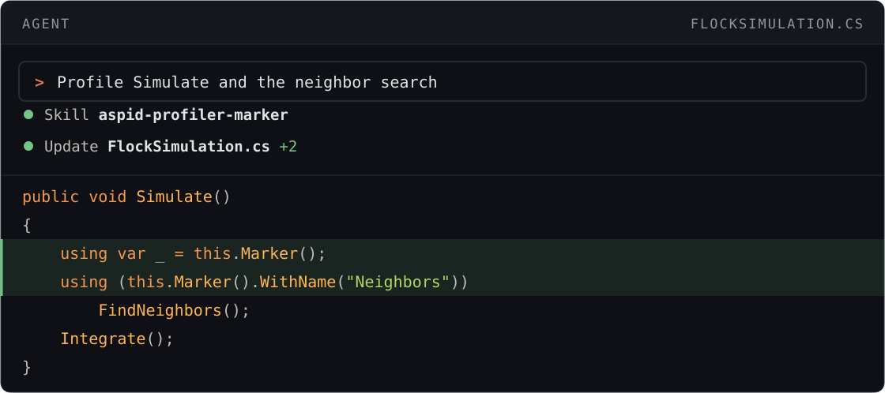
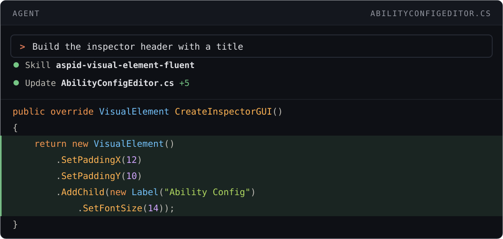
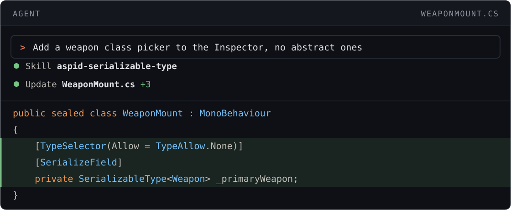
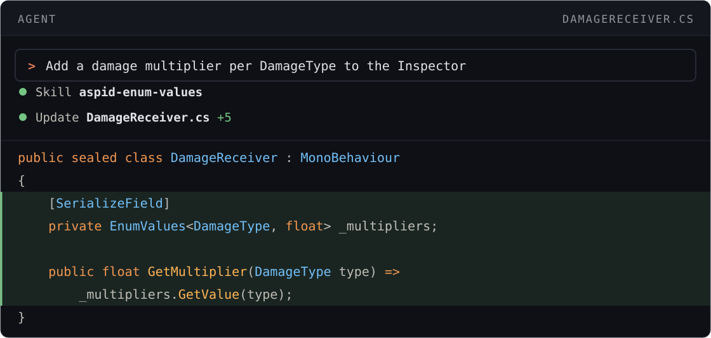

# Agent Skills

Skills that make a coding agent write code with Aspid.FastTools instead of the raw Unity API.

## Quick start

[Install Aspid.FastTools](README.md#installation) in your Unity project. The skills installer needs Node.js 22.20 or newer.

> [!NOTE]
> Releases up to and including `1.0.0-rc.8` do not ship the skills. With one of them, see [Versions and updates](#versions-and-updates) first.

Ask your agent:

```text prompt
Install the skills from VPDPersonal/Aspid.FastTools in the current project,
not globally. Run npx skills add VPDPersonal/Aspid.FastTools#skills-preview.
```

Or run in the project root:

```bash
npx skills add VPDPersonal/Aspid.FastTools#skills-preview
```

In the installer, choose the **Project** scope: a global install applies to every Unity project, whatever its package version.

```text prompt
Profile Simulate and the neighbor search
```

| Without skills | With skills |
|---|---|
| <pre lang="csharp"><code>private static readonly&#10;    ProfilerMarker _simulate =&#10;    new("Flock.Simulate");&#10;private static readonly&#10;    ProfilerMarker _neighbors =&#10;    new("Flock.FindNeighbors");&#10;&#10;public void Simulate()&#10;&#123;&#10;    using var _ = _simulate.Auto();&#10;    using (_neighbors.Auto())&#10;        FindNeighbors();&#10;    Integrate();&#10;&#125;</code></pre> | <pre lang="csharp"><code>public void Simulate()&#10;&#123;&#10;    using var _ = this.Marker();&#10;    using (this.Marker()&#10;        .WithName("Neighbors"))&#10;        FindNeighbors();&#10;    Integrate();&#10;&#125;</code></pre> |

## Versions and updates

The skills come from release branches, never from `main`. Each channel of the package has its own: `skills-preview` gets every preview release, as `upm-preview` does, and `skills` every stable one, as `upm` does. Install from the channel of your package. `npx skills update` moves the skills to the newest release of that channel, and it updates every skill in the project, not only these.

Update the package at the same time: skills newer than your package can describe API that it does not have, so the agent writes code that does not compile. To keep the skills at your package version, install them from its tag, which `npx skills update` does not move:

```bash
npx skills add VPDPersonal/Aspid.FastTools#skills-preview/<version>
```

Releases up to and including `1.0.0-rc.8` do not ship the skills. With one of them, upgrade the package to a release that does.

The skills used to ship as the `aspid-fasttools` Claude Code plugin. If you have it, remove it with `/plugin uninstall aspid-fasttools@aspid-claude-plugins`: it teaches the agent API that no longer exists.

## Skills

Skills activate automatically for matching requests.

### aspid-profiler-marker

Profile a method or a section with <code lang="csharp">this.Marker()</code>. Guide: [ProfilerMarkers](09-profiler-markers.md).



### aspid-visual-element-fluent

Build and style UI Toolkit elements in C#. Guide: [VisualElement Extensions](10-visual-element-extensions.md).



### aspid-serializable-type

Store a <code lang="class-name">System.Type</code>, pick types in the Inspector and fail a CI job on missing types. Guides: [Serializable Types](02-serializable-types.md), [TypeSelector](03-type-selector.md), [SerializeReference Selector](04-serialize-reference-selector.md), [ComponentTypeSelector](05-component-type-selector.md), [Build and CI checks](07-serialize-reference-validation.md).



### aspid-enum-values

Map enum members to values. Guide: [EnumValues](08-enum-values.md).


