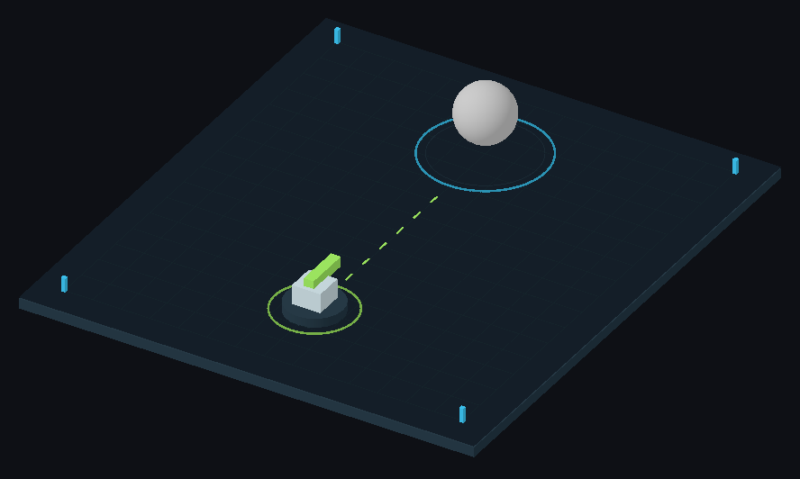

# Пример SerializeReferences

Турель, у которой оружие и его эффекты выбираются в инспекторе.

Манекен меняет цвет и уменьшается от урона настроенного оружия и эффектов.

## Как открыть

1. Импортируйте пример: **Tools → Aspid 🐍 → FastTools → Welcome** → **Samples** → **Import** у **SerializeReferences**.
2. Откройте `Scenes/SerializeReferences.unity` и войдите в Play Mode: основное и запасное оружие по очереди бьют манекен.

## Попробуйте

Выйдите из Play Mode и выберите **Loadout**.

1. **Выбор класса.** Откройте список **Primary**: окно выбора перечисляет все классы <code lang="class-name">IWeapon</code>, а выбранный класс показывает свои поля под списком.
2. **Значения сохраняются.** В **Sidearms** поставьте у <code lang="class-name">Pistol</code> **Damage** = `37`, переключите его на <code lang="class-name">Shotgun</code> и обратно: **Damage** по-прежнему `37`, потому что `_damage` есть в обоих классах.
3. **Списки.** Нажмите **+** у **Sidearms**: откроется окно выбора, а новый элемент получит собственный экземпляр.
4. **Вложенные ссылки.** У <code lang="class-name">Railgun</code> в **Primary** есть своё поле <code lang="csharp">[SerializeReference]</code> — **Charge Effect** с <code lang="class-name">BurnEffect</code>: от попадания рейлгана манекен загорается.
5. **Абстрактная база.** **On Hit** — <code lang="class-name">StatusEffect</code>: окно выбора предлагает <code lang="class-name">BurnEffect</code> и <code lang="class-name">FreezeEffect</code>, но не абстрактный класс.
6. **Меню заголовка.** Правый клик по заголовку поля — копирование, вставка и другие действия: [все пункты](../../../docusaurus-plugin-content-docs/current/04-serialize-reference-selector.md#меню-заголовка).

## Куда смотреть

| Файл | Что показывает |
|---|---|
| `Scripts/Loadout.cs` | <code lang="csharp">[TypeSelector]</code> на одиночном поле, списке и абстрактной базе |
| `Scripts/Weapons/Railgun.cs` | Вложенный <code lang="csharp">[SerializeReference]</code> |

Справочник — [SerializeReference Selector](../../../docusaurus-plugin-content-docs/current/04-serialize-reference-selector.md).
