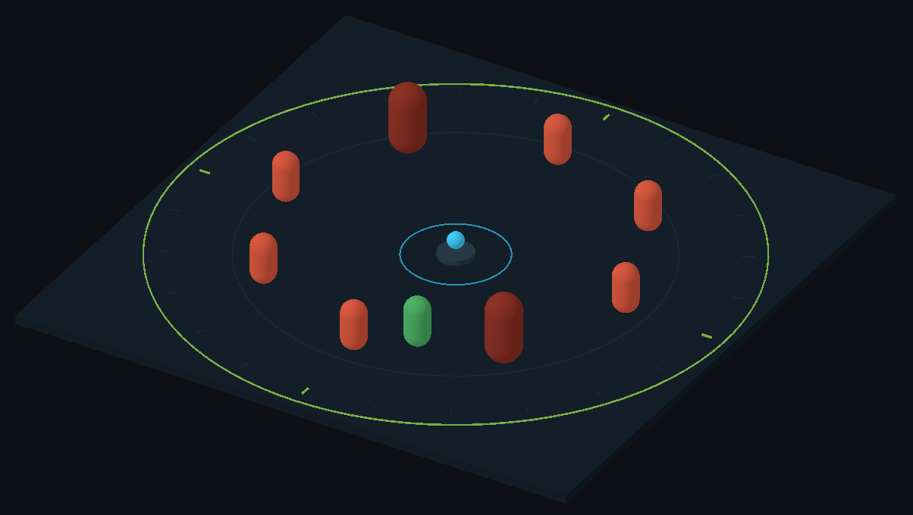
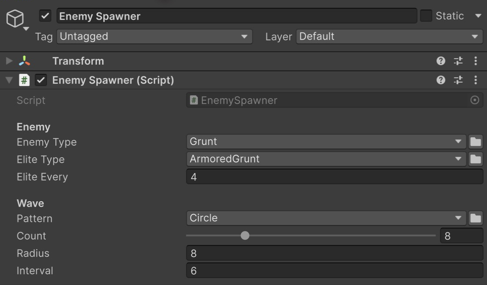

# Пример Types

Спавнер, в котором тип врага и схема волны выбираются в инспекторе, без правки кода.

Волна обычных и элитных врагов движется к центру.

## Как открыть

1. Импортируйте пример: **Tools → Aspid 🐍 → FastTools → Welcome** → **Samples** → **Import** у **Types**.
2. Откройте `Scenes/Types.unity` и войдите в Play Mode: каждые шесть секунд по кругу появляются восемь врагов, каждый четвёртый — <code lang="class-name">ArmoredGrunt</code>, и идут к центру.

## Попробуйте

Выйдите из Play Mode и выберите **Enemy Spawner**.

Типы врагов и паттерн расстановки в инспекторе.

1. **Тип переживает переименование.** **Enemy Type** — <code lang="class-name">SerializableMonoScript&lt;Enemy&gt;</code>. Переименуйте <code lang="class-name">Grunt</code> вместе с файлом в <code lang="class-name">Footman</code>: после компиляции поле показывает <code lang="class-name">Footman</code>.
2. **Зависимое окно выбора.** **Elite Type** предлагает только класс из **Enemy Type** и его наследников. Переключите **Enemy Type** на <code lang="class-name">Archer</code> и откройте **Elite Type**: остался только <code lang="class-name">Archer</code>.
3. **Имена, группы и иконки.** Откройте **Pattern**: **Circle** и **Line** собраны в группу **Spawn Patterns** с иконками из <code lang="csharp">[TypeSelectorDisplay]</code>, а скрытого через `Hidden` <code lang="class-name">OriginPattern</code> в списке нет. Выберите **Line** и войдите в Play Mode: враги появятся в линию.
4. **Замена компонента на месте.** Выберите **Placed Enemy (swap its type)** и поставьте **Health** = `250`. В списке <code lang="class-name">ComponentTypeSelector</code> вверху инспектора переключите <code lang="class-name">Archer</code> на <code lang="class-name">Grunt</code>: **Health** осталось `250`, а **Keep Distance**, которое есть только у <code lang="class-name">Archer</code>, исчезло.

## Куда смотреть

| Файл | Что показывает |
|---|---|
| `Scripts/EnemySpawner.cs` | <code lang="class-name">SerializableMonoScript&lt;T&gt;</code>, <code lang="class-name">SerializableType&lt;T&gt;</code> и <code lang="csharp">[TypeSelector]</code>, зависящий от другого поля |
| `Scripts/Enemies/Enemy.cs` | Поле <code lang="class-name">ComponentTypeSelector</code> |
| `Scripts/Spawning/` | Имена, группы и иконки из <code lang="csharp">[TypeSelectorDisplay]</code> |

Справочник — [Serializable Types](../../../docusaurus-plugin-content-docs/current/02-serializable-types.md), [TypeSelector](../../../docusaurus-plugin-content-docs/current/03-type-selector.md) и [ComponentTypeSelector](../../../docusaurus-plugin-content-docs/current/05-component-type-selector.md).
