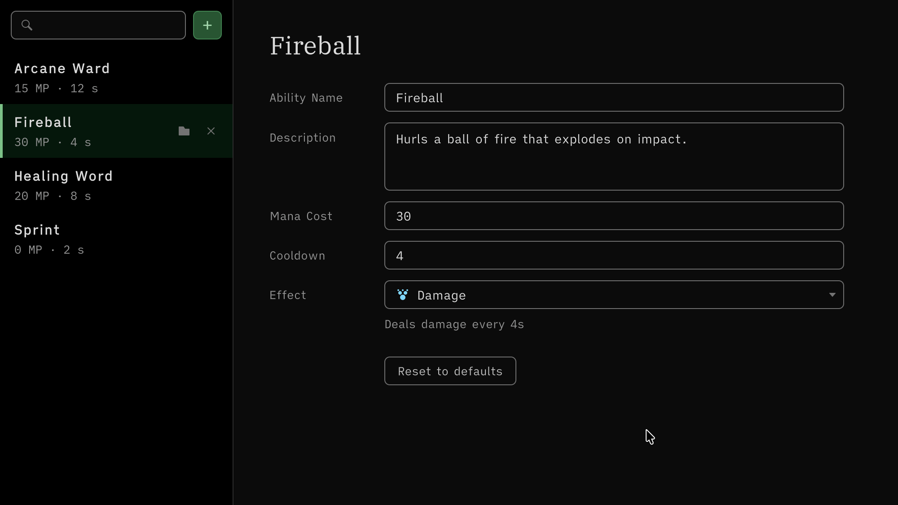

# EditorTools Sample

An editor window and an Inspector built in code with the package's helpers.



The Reset to defaults button returns the cost and the cooldown to their defaults, and Undo restores them.

## Open it

1. Import the sample: **Tools → Aspid 🐍 → FastTools → Welcome** → **Samples** → **Import** on **EditorTools**. It has no scene.
2. Open **Tools → Aspid 🐍 → FastTools → Samples → Ability Catalog**: the left pane lists the project's abilities, the four assets from `Data/` among them, and the right pane shows the selected one.

## Try

1. **A ListView in one chain.** The list on the left is one chain of <code lang="class-name">ListView</code> extensions, <code lang="function">SetMakeItem</code>, <code lang="function">SetBindItem</code> and <code lang="function">AddSelectionChanged</code> included. Type in the search field: <code lang="function">AddValueChanged</code> filters the source, and <code lang="function">RefreshItems</code> redraws the list.
2. **Binding.** The name, description, cost and cooldown fields sit in one container bound with <code lang="csharp">.BindTo(serializedObject)</code>. Edit the name: the list and the title follow, and Undo restores it.
3. **Typed property setters.** Select **Fireball** and press **Reset to defaults**: **Mana Cost** and **Cooldown** take the values of the field initializers of <code lang="class-name">AbilityConfig</code>, read from a fresh instance. The handler writes two properties and applies them once, so a single Undo reverts both:

   ```csharp
   var defaults = CreateInstance<AbilityConfig>();
   serializedObject.Update();
   serializedObject.FindProperty("_cooldown").SetFloat(defaults.Cooldown);
   serializedObject.FindProperty("_manaCost").SetIntAndApply(defaults.ManaCost);
   DestroyImmediate(defaults);
   ```

4. **The type picker from code.** Click the **Effect** field: <code lang="csharp">TypeSelectorWindow.Show()</code> opens the picker of <code lang="csharp">[TypeSelector]</code> at the field, limited to <code lang="class-name">IAbilityEffect</code> implementations, and writes the pick into a string property. The effects carry <code lang="csharp">[TypeSelectorDisplay]</code>, so the picker lists them as Damage, Heal and Shield in an Effects group, with icons and tooltips, and the field shows the same name and icon. Pick **Heal** and change **Mana Cost**: the effect description under the field follows the value, through Undo and Redo too.
5. **Open the script.** Double-click the ability title in the right pane: <code lang="function">AddOpenScriptCommand</code> opens `AbilityConfig.cs` in your IDE.
6. **The inspector.** Select `Data/Sprint.asset` in the Project window. <code lang="class-name">AbilityConfigEditor</code> draws a card titled with <code lang="csharp">GetDisplayName()</code>, “Ability Config”, a cost badge and a warning shown while **Mana Cost** is `0`; <code lang="csharp">PropertyField.AddValueChanged()</code> drives both. Set the cost to `10` and back.
7. **Create and delete.** Press **+**: a new asset appears next to the selected one, already selected in the list. Hover a row: its buttons select the asset in the Project window and, after a confirmation, move it to the trash.
8. **The FastTools theme.** Open **Tools → Aspid 🐍 → FastTools → Settings** and pick another **Theme** under **Appearance**: <code lang="function">AddAspidTheme</code> recolours the open catalog at once.

## Where to look

| File | Shows |
|---|---|
| `Scripts/Editor/AbilityCatalogWindow.cs` | <code lang="class-name">ListView</code> extensions, <code lang="function">BindTo</code>, <code lang="function">SetFloat</code> and <code lang="function">SetIntAndApply</code>, <code lang="csharp">TypeSelectorWindow.Show()</code> with a <code lang="class-name">TypeSelectorFilter</code>, <code lang="function">AddOpenScriptCommand</code>, <code lang="function">AddAspidTheme</code> |
| `Scripts/Editor/AbilityCatalog.uss` | The window's colours, taken only from the `--aspid-colors-*` tokens of the theme |
| `Scripts/Editor/AbilityConfigEditor.cs` | A custom inspector on the style and layout setters, <code lang="function">GetDisplayName</code> |
| `Scripts/AbilityConfig.cs` | The data; <code lang="csharp">[TypeSelector]</code> on the effect string gives the asset's Inspector the same picker |
| `Scripts/Effects/` | The effect classes the picker offers, with <code lang="csharp">[TypeSelectorDisplay]</code> names, a group and icons |

Reference: [VisualElement Extensions](../../docs/10-visual-element-extensions.md), [SerializedProperty Extensions](../../docs/11-serialized-property-extensions.md), [Editor Helpers](../../docs/12-editor-helpers.md) and [TypeSelectorWindow](../../docs/03-type-selector.md#typeselectorwindow).
