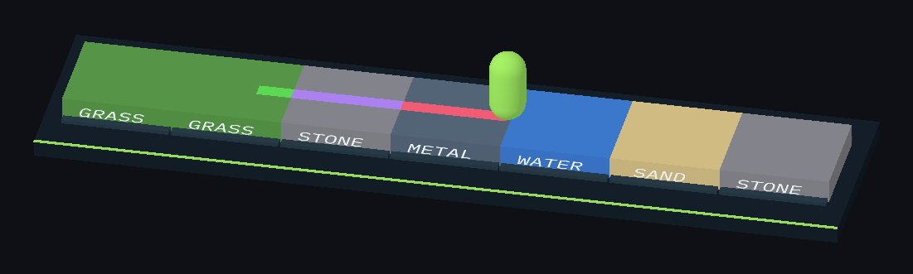
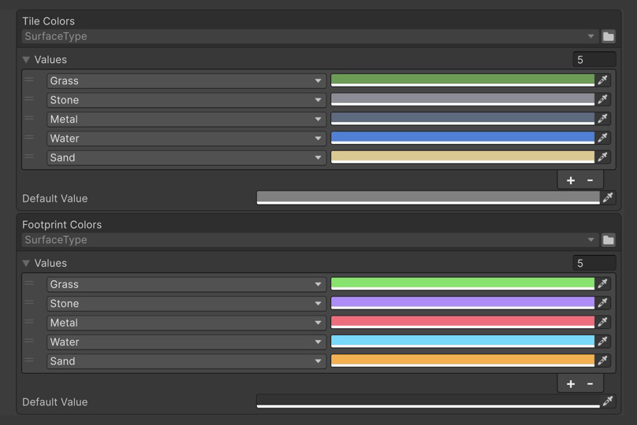

# EnumValues Sample

A walker crosses surface tiles, and each surface's color, trail and speed come from tables in the Inspector.



The walker crosses different surfaces and leaves a continuous colored trail.

## Open it

1. Import the sample: **Tools → Aspid 🐍 → FastTools → Welcome** → **Samples** → **Import** on **EnumValues**.
2. Open `Scenes/EnumValues.unity` and enter Play Mode: the walker speeds up on metal, slows down on wet and soft tiles, and leaves a trail in each surface's color.

## Try

### 1. Enum fixed in code

Select `Data/SurfacePalette.asset` and change `Grass` in **Tile Colors**: the tiles recolor at once.



Tile Colors and Footprint Colors, each with its own Default Value.

```csharp
[SerializeField] private EnumValues<SurfaceType, Color> _tileColors;

public Color GetTileColor(SurfaceType surface) =>
    _tileColors.GetValue(surface);
```

### 2. Default value

Remove the `Stone` row from **Footprint Colors** and enter Play Mode: the trail on stone takes the table's **Default Value**.

### 3. Enum picked in the Inspector

Select **Walker**: the code of **Speed By Terrain** sets only the value type, and the <code lang="class-name">TerrainFlags</code> enum is picked in the table header.

```csharp
[SerializeField] private EnumValues<float> _speedByTerrain;

var speed = _speed * (_tile == null
    ? 1f
    : _speedByTerrain.GetValue(_tile.Flags));
```

### 4. `[Flags]` keys

<code lang="function">GetValue</code> returns the value of one row:

| Key | Row | Multiplier |
|---|---|---|
| `Wet, Slippery` | the exact row | `0.5` |
| `Wet, Hot` | the first row inside the key, `Wet` | `0.8` |
| `None` | no row, **Default Value** | `1` |

### 5. A new enum member

Add `Ice` to <code lang="class-name">SurfaceType</code> and set one tile's **Surface** to `Ice`: the tile and its trail take the default values.

## Where to look

| File | Shows |
|---|---|
| `Scripts/SurfacePalette.cs` | <code lang="class-name">EnumValues&lt;TEnum, TValue&gt;</code> on a ScriptableObject |
| `Scripts/Walker.cs` | <code lang="class-name">EnumValues&lt;TValue&gt;</code> with a <code lang="csharp">[Flags]</code> key |

Reference: [EnumValues](../../docs/08-enum-values.md).
