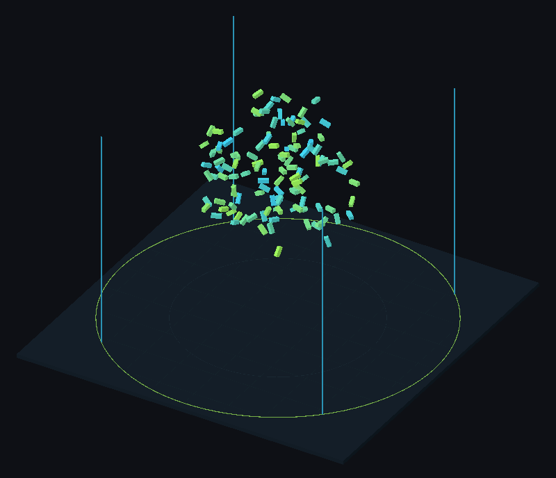
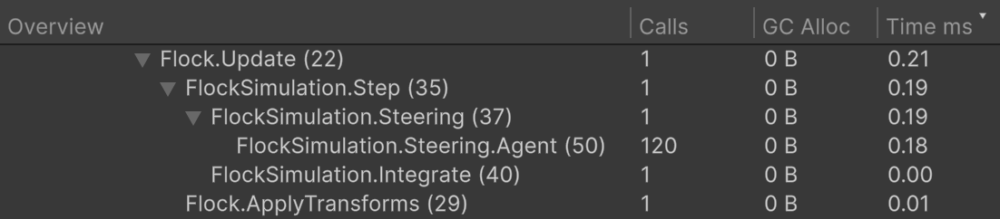

# ProfilerMarkers Sample

A flock of cubes whose every frame phase shows up in the Profiler under its own name.



The flock simulation whose phases the markers measure.

## Open it

1. Import the sample: **Tools → Aspid 🐍 → FastTools → Welcome** → **Samples** → **Import** on **ProfilerMarkers**.
2. Open `Scenes/ProfilerMarkers.unity` and **Window → Analysis → Profiler**, enter Play Mode and select a frame in the CPU module.
3. In the **Hierarchy** view, expand `PlayerLoop` down to <code lang="string">Flock.Update (22)</code>.

## Try



The markers under Flock.Update nest like the code; FlockSimulation.Steering.Agent has 120 calls for 120 agents.

1. **The tree follows the <code lang="csharp">using</code> scopes.** Nothing else sets the nesting:

   ```csharp
   public void Step(float deltaTime, float neighborRadius, float maxSpeed)
   {
       using var _ = this.Marker();

       using (this.Marker().WithName("Steering"))
           ComputeSteering(neighborRadius);

       using (this.Marker().WithName("Integrate"))
           Integrate(deltaTime: deltaTime, maxSpeed: maxSpeed);
   }
   ```

2. **One marker per loop.** <code lang="string">FlockSimulation.Steering.Agent</code> sits in the loop over the agents: one row, with `Calls` equal to the agent count.
3. **More agents.** In Play Mode, set **Count** on **Flock** to `400`: `Calls` becomes `400`.
4. **Not only MonoBehaviour.** <code lang="class-name">FlockSimulation</code> is a plain C# class. The marker in the local function <code lang="function">CreateAgent</code> takes the method's name, <code lang="string">Flock.InitializeAgents (58)</code>, and shows up in the frame where **Count** changes.
5. **The line number in the name.** Every name ends with the line of its call, <code lang="string">FlockSimulation.Steering (37)</code>, so two markers in one method never share a name.
6. **Release builds.** In a player build without **Development Build** the markers measure nothing.

## Where to look

| File | Shows |
|---|---|
| `Scripts/FlockSimulation.cs` | Method, block and per-iteration markers in a plain class |
| `Scripts/Flock.cs` | A marker in a local function |

Reference: [ProfilerMarkers](../../docs/09-profiler-markers.md).
